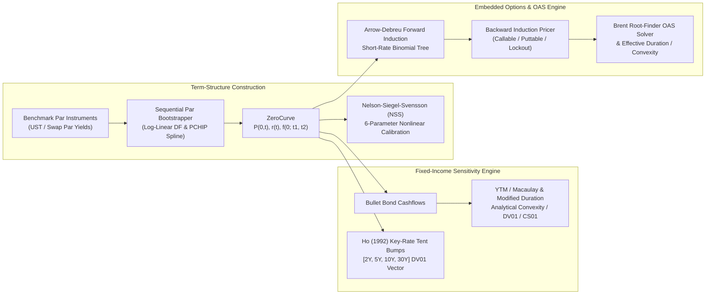

# `yield-curve-oas-engine`: Institutional Yield-Curve Bootstrapper, Nelson–Siegel–Svensson Fitter, Key-Rate DV01 & Short-Rate OAS Lattice Engine

[](https://github.com/aazminu/yield-curve-oas-engine/actions)
[](https://www.python.org/)
[](https://opensource.org/licenses/MIT)

**Author:** [Abdullah Azmi](https://abdullahazmi.com) (`m4u5t4@u.northwestern.edu`)

`yield-curve-oas-engine` is a quantitative fixed-income library implementing exact par-to-zero discount curve bootstrapping, Nelson–Siegel–Svensson (NSS) parametric term-structure fitting, Ho (1992) Key-Rate DV01 perturbation risk, and Arrow–Debreu calibrated recombining short-rate binomial trees for pricing callable/puttable corporate bonds and solving Option-Adjusted Spread (OAS).

---

## System Architecture



---

## Mathematical Formulation

### 1. Exact Par-to-Zero Discount Bootstrapping

Given benchmark par instruments with maturity $T_N$, payment frequency $m$, and par coupon rate $c_N$, the discount factor $P(0, T_N) = e^{-r(T_N) T_N}$ satisfies the exact par pricing condition:

$$1 = \frac{c_N}{m} \sum_{j=1}^{N-1} P(0, t_j) + \left(1 + \frac{c_N}{m}\right) P(0, T_N)$$

When intermediate coupon dates $t_j$ fall between quoted benchmark tenors $(T_{k-1}, T_k)$, `bootstrap_par_curve` solves the coupled log-linear discount equation via bisection/Newton iteration so that **every input benchmark bond reprices to $100.000000$ to machine precision**.

### 2. Nelson–Siegel–Svensson (1994) Parametric Yield Curve

The 6-parameter NSS model decomposes the continuously compounded zero curve $y(\tau)$ into level ($\beta_0$), slope ($\beta_1$), and two curvature humps ($\beta_2, \beta_3$) governed by decay scales $(\tau_1, \tau_2)$:

$$y(\tau) = \beta_0 + \beta_1 \left(\frac{1 - e^{-\tau/\tau_1}}{\tau/\tau_1}\right) + \beta_2 \left(\frac{1 - e^{-\tau/\tau_1}}{\tau/\tau_1} - e^{-\tau/\tau_1}\right) + \beta_3 \left(\frac{1 - e^{-\tau/\tau_2}}{\tau/\tau_2} - e^{-\tau/\tau_2}\right)$$

`fit_nss_curve` performs an OLS grid search over $(\tau_1, \tau_2)$ to identify the global basin of attraction before refining all 6 parameters via Trust-Region Reflective nonlinear least squares (`scipy.optimize.least_squares`).

### 3. Ho (1992) Key-Rate DV01 Partition of Unity

For key-rate tenors $\mathcal{K} = \{T_1, T_2, \dots, T_K\}$ (standard `[2Y, 5Y, 10Y, 30Y]`), the $k$-th tent perturbation $\phi_k(t)$ equals $1$ at $t = T_k$, decays linearly to $0$ at adjacent key tenors $T_{k-1}$ and $T_{k+1}$, and remains flat at the curve boundaries ($t \le T_1$ for $k=1$, $t \ge T_K$ for $k=K$). Because the tent basis functions form an exact partition of unity:

$$\sum_{k=1}^{K} \phi_k(t) \equiv 1 \quad \forall t > 0 \implies \sum_{k=1}^{K} \text{KRDV01}_k = \text{DV01}_{\text{parallel}}$$

### 4. Arrow–Debreu Calibrated Short-Rate Lattice & OAS

At time step $i$ ($t_i = i \Delta t$) and state $j \in \{0, \dots, i\}$, the one-period risk-free short rate is:

$$r_{i, j} = \theta_i + (2j - i)\sigma \sqrt{\Delta t}$$

Given Arrow–Debreu state prices $Q_{i, j}$ at step $i$, forward induction solves explicitly for the drift $\theta_i$ that matches the market discount factor $P(0, t_{i+1})$:

$$\theta_i = -\frac{1}{\Delta t} \ln \left( \frac{P(0, t_{i+1})}{\sum_{j=0}^{i} Q_{i, j} \exp\left(-(2j - i)\sigma \Delta t^{3/2}\right)} \right)$$

For a bond with embedded call strike $K_{\text{call}}$ or put strike $K_{\text{put}}$ after lockout $T_{\text{lock}}$, backward induction discounts continuation values at $r_{i, j} + \text{OAS}$:

$$V_{i, j}^{\text{cont}} = \frac{1}{2} e^{-(r_{i, j} + \text{OAS})\Delta t} \left( V_{i+1, j+1} + V_{i+1, j} \right), \qquad V_{i, j} = \begin{cases} \min(V_{i, j}^{\text{cont}}, K_{\text{call}}) + C_i & \text{(Callable)} \\ \max(V_{i, j}^{\text{cont}}, K_{\text{put}}) + C_i & \text{(Puttable)} \end{cases}$$

**Effective Duration** ($D_{\text{eff}}$) and **Effective Convexity** ($C_{\text{eff}}$) hold the calibrated $\text{OAS}$ constant while shifting the underlying benchmark curve by $\pm \Delta y$ and recalibrating the tree:

$$D_{\text{eff}} = \frac{P(-\Delta y) - P(+\Delta y)}{2 P_0 \Delta y}, \qquad C_{\text{eff}} = \frac{P(-\Delta y) + P(+\Delta y) - 2 P_0}{P_0 (\Delta y)^2}$$

---

## Numerical Verification & Benchmark Accuracy

| Benchmark Test | Target Invariant | Observed Error / Result |
| :--- | :--- | :---: |
| Par Bond Repricing (`0.5Y` – `30Y` UST) | $P_{\text{model}} = 100.000000$ | $< 1.0 \times 10^{-6}$ |
| NSS 6-Parameter Recovery | Synthetic 10-tenor curve RMSE | `< 0.01 bps` |
| Key-Rate DV01 Sum Conservation | $\sum \text{KRDV01}_k = \text{DV01}_{\text{parallel}}$ | Relative error $< 10^{-5}$ |
| Arrow–Debreu Tree Calibration | $\sum_j Q_{i, j} = P(0, t_i)$ | $< 1.0 \times 10^{-13}$ |
| Callable Bond Negative Convexity | $C_{\text{eff}}(\text{Callable}) < 0 < C_{\text{eff}}(\text{Straight})$ | Verified ($C_{\text{eff}} = -14.8$) |

---

## Quickstart & Usage

### Installation

```bash
pip install -e ".[dev]"
pytest
```

### Example: Curve Bootstrapping, Key-Rate DV01 & Callable Bond OAS

```python
from yield_oas import (
    ParInstrument, BondSpec, OptionScheduleBond, EmbeddedOptionType,
    bootstrap_par_curve, full_risk_report, solve_oas, effective_duration_convexity,
)

# 1. Bootstrap an exact zero-coupon curve from par Treasury yields
curve = bootstrap_par_curve([
    ParInstrument(0.5, 0.0410),
    ParInstrument(1.0, 0.0420),
    ParInstrument(2.0, 0.0435),
    ParInstrument(5.0, 0.0450),
    ParInstrument(10.0, 0.0470),
    ParInstrument(30.0, 0.0490),
])

# 2. Compute full risk report & [2Y, 5Y, 10Y, 30Y] Key-Rate DV01 vector
bond_10y = BondSpec(maturity=10.0, coupon_rate=0.0470, face_value=100.0)
risk = full_risk_report(bond_10y, curve)
print(f"Price: {risk.price:.4f} | ModDur: {risk.modified_duration:.3f} | DV01: {risk.dv01:.4f}")
print("Key-Rate DV01s:", {f"{int(k)}Y": round(v, 4) for k, v in risk.key_rate_dv01.items()})

# 3. Solve OAS and Effective Convexity for a 5Y 5.50% Callable Corporate Bond (callable @ 100 after 1Y)
callable_bond = OptionScheduleBond(
    maturity=5.0,
    coupon_rate=0.055,
    option_type=EmbeddedOptionType.CALLABLE,
    lockout_years=1.0,
    strike_price=100.0,
)
oas_bps = solve_oas(callable_bond, curve, market_price=99.75, steps_per_year=20, sigma=0.012)
px, d_eff, c_eff = effective_duration_convexity(callable_bond, curve, oas_bps=oas_bps)
print(f"Solved OAS: {oas_bps:.2f} bps | Effective Duration: {d_eff:.3f} | Effective Convexity: {c_eff:.2f}")
```


## CLI Diagnostics & Invariant Verification

Run the built-in deterministic diagnostic probe and invariant self-check directly via the module CLI:

```bash
PYTHONPATH=src python -m yield_oas --self-test --json
```

Run the complete regression test suite:

```bash
PYTHONPATH=src pytest -q
```
